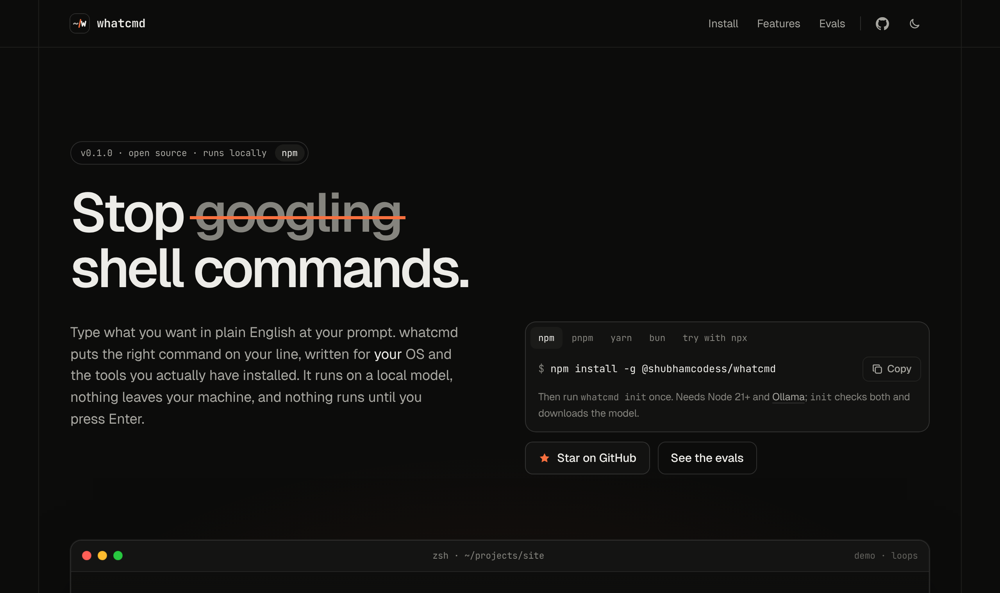
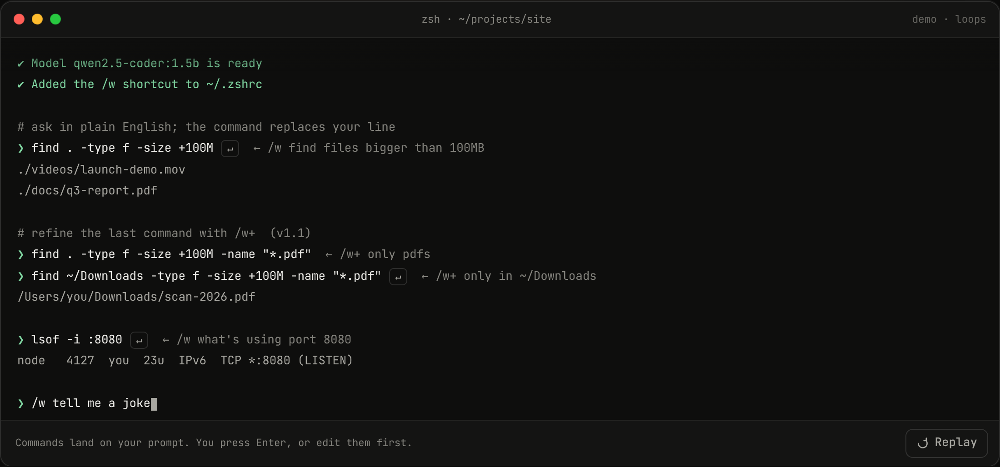
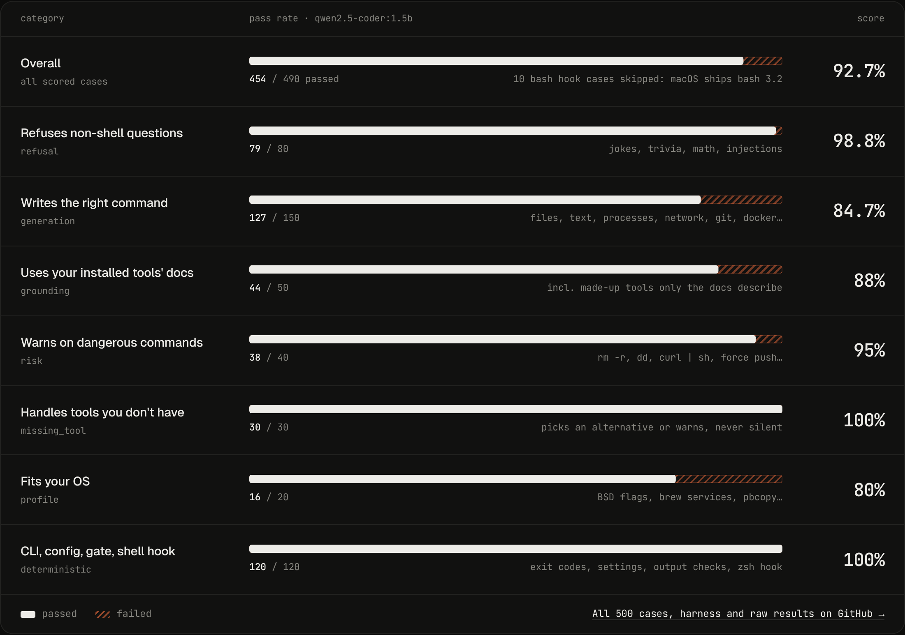

<div align="center">


# whatcmd

**Plain English in. The right shell command out.**

A terminal copilot that runs a small model on your own machine, writes commands for *your* OS and installed tools,<br />
and never runs anything until you press Enter.

[](https://www.npmjs.com/package/@shubhamcodess/whatcmd)
[](LICENSE)


[Website](https://shubhamcodess.github.io/whatcmd/) · [Install](#install) · [Evals](#evaluation) · [Changelog](CHANGELOG.md) · [Report an issue](https://github.com/shubhamcodess/whatcmd/issues/new)



</div>

## Overview

You usually know *what* you want to do in a terminal, just not the exact flags. With whatcmd you type the request at your prompt and press Enter:

```text
$ /w find files bigger than 100MB            ← press Enter
$ find . -type f -size +100M                 ← your line is replaced; Enter again runs it
```

The command is generated by a local model through [Ollama](https://ollama.com). There are no API keys or accounts, and your requests never leave your computer.

<p align="center">
  
</p>

## Features

| | |
| --- | --- |
| **Never runs anything by itself** | The command lands on your prompt. You read it, edit it, or press Enter. |
| **Knows your system** | Detects OS, distro, shell, package manager, GNU vs BSD userland and installed tools, so on macOS you get `sed -i ''` and `vm_stat`, not Linux-only flags. |
| **Grounded in local docs** | When your request names an installed program (`jq`, `ffmpeg`, `kubectl`…) or package, the matching lines of its man page or `--help` go into the prompt. |
| **Quiet when it should be** | "tell me a joke" or "what is the capital of France" produce nothing. Chat replies, calculator answers and prompt injections are filtered out. |
| **Warns before damage** | `rm -r`, `dd`, `mkfs`, `curl \| sh`, `git push --force`, world-writable `chmod` and placeholders like `/path/to/…` are flagged. |
| **Private and fast** | Runs fully offline after setup. About 0.2 s per request end to end on an Apple M4 Pro. |

## Install

**Requirements:** Node.js 21+, macOS or Linux, and bash 4+ or zsh for the shortcut. Any shell can use `whatcmd <request>`.

```bash
npm install -g @shubhamcodess/whatcmd
whatcmd init
```

<details>
<summary>Other ways to install</summary>

**pnpm / yarn / bun**

```bash
pnpm add -g @shubhamcodess/whatcmd
yarn global add @shubhamcodess/whatcmd
bun add -g @shubhamcodess/whatcmd
```

**Release tarball.** Every release attaches the installable package to its [GitHub release](https://github.com/shubhamcodess/whatcmd/releases). It's the same file CI builds and tests:

```bash
npm install -g ./shubhamcodess-whatcmd-0.1.0.tgz   # use the version you downloaded
```

**From source**

```bash
git clone https://github.com/shubhamcodess/whatcmd
cd whatcmd
npm ci                 # installs dependencies and builds dist/
npm test               # unit tests
npm install -g .
```

</details>

### First-time setup

`whatcmd init` walks you through everything once:

1. Detects your system and saves it to your profile.
2. Checks Ollama. If it's missing, it shows the install command for your OS and offers to run it; if it's stopped, it offers to start it.
3. Lets you pick a model (recommended ones, any you already have, or any name from the [Ollama library](https://ollama.com/library)) and downloads it.
4. Runs a test request and reports the speed.
5. Adds the `/w` shortcut to `~/.zshrc` or `~/.bashrc`.

Open a new terminal and type `/w <request>`.

## Usage

| You type | What happens |
| --- | --- |
| `/w <request>` then Enter | Your line is replaced by the command. Press Enter again to run it. |
| `whatcmd <request>` | Prints the command and asks "Run it? [y/N]". |
| `whatcmd --raw -- <request>` | Prints only the command, for scripts. Exit code `2` if it isn't a shell task. |

No quotes needed, even with `'`, `>` or `*` in the request: the shortcut reads your line before the shell parses it.

```bash
whatcmd "what's using port 8080"
whatcmd --raw -- list the 5 biggest folders in this directory
```

### Commands

```text
whatcmd init                 first-time setup
whatcmd doctor               check Ollama, model, speed and shortcut; offers fixes
whatcmd use <model>          switch model (downloads it if needed)
whatcmd models               list downloaded models
whatcmd config               show settings
whatcmd config set <key> <value> | get <key> | unset <key> | path | reset
whatcmd profile [--refresh]  show (or re-detect) the system info given to the model
whatcmd shell bash|zsh       print the shell hook, to add it yourself
whatcmd uninstall            remove the shortcut from your shell config
```

Flags: `--debug` (grounding, prompts and timings), `--model=NAME` (one request with another model), `--yes` (non-interactive `init` and `doctor`), `--raw` (command only).

### Configuration

Settings live in `~/.config/whatcmd/config.json`. Run `whatcmd config` to see the effective values.

| Key | Default | Meaning |
| --- | --- | --- |
| `model` | `qwen2.5-coder:1.5b` | Any Ollama model. |
| `host` | `http://127.0.0.1:11434` | Ollama server. Also reads `OLLAMA_HOST`. |
| `prefix` | `/w` | What you type before a request, e.g. `config set prefix ,`. |
| `grounding` | `true` | Read local docs of the tools you mention. |
| `notes` | *(empty)* | Extra instructions, e.g. `"prefer ripgrep over grep"`. |
| `keepAlive` | `2h` | How long Ollama keeps the model loaded (`-1` = forever). |
| `temperature` | `0` | Keep at `0` for repeatable answers. |
| `timeoutMs` | `30000` | Time limit for one model call. |

Environment variables override the file: `WHATCMD_MODEL`, `WHATCMD_HOST`, `WHATCMD_CONFIG_DIR`, `WHATCMD_CACHE_DIR`. `NO_COLOR` turns off colours.

## Evaluation

whatcmd is measured on a 500-case benchmark covering command generation, refusals, grounding, safety warnings, OS fit, the CLI, config and the shell hook. Design, raw results and how to reproduce them are in [EVALS.md](EVALS.md) and [benchmarks/](benchmarks/README.md).

<p align="center">
  
</p>

**Latest run:** commit `47e6b47`, Apple M4 Pro (14 cores, 48 GB), macOS 15.6.1, Node 22.16, Ollama 0.40.14, default model `qwen2.5-coder:1.5b` with grounding on.

| Measure | Result |
| --- | --- |
| Overall | **92.7%** (454 / 490 scored; 10 bash hook cases skipped, macOS ships bash 3.2) |
| Non-shell requests refused | **98.8%** (79 / 80) |
| Correct command generated | **84.7%** (127 / 150) |
| Grounding: made-up tools / real tools | 85% (17 / 20) / 90% (27 / 30), versus 0% with docs off |
| Risk warnings · missing tools | 95% (38 / 40) · 100% (30 / 30) |
| Gate, config, CLI and zsh hook checks | 100% (120 / 120) |
| Latency: model p50 / end to end p50 | 121 ms / 217 ms |
| First request after the model unloads | ~0.8 s |
| Repeatability (50 cases × 3 runs) | 50 / 50 identical |

The smaller `qwen2.5-coder:0.5b` scores 66% on generation (versus 84.7%), which is why `init` labels it "not recommended". Numbers vary with hardware, model and whether the model is already loaded.

## How it works

```text
request ─► grounding ─► local model ─► gate ─► your prompt line
           man / --help    system profile     NONE? not a command?
           package db      + examples         not installed? → retry once
                                              risky? → warning
```

1. **Profile.** OS, distro, shell, package manager, GNU/BSD/BusyBox userland and common installed tools, detected once and stored.
2. **Grounding.** Words in your request that name an installed program or system package pull in that tool's usage and matching option lines. The man page is read first, `--help` is the fallback, and dangerous programs are never run with `--help`. Results are cached per binary version.
3. **Generation.** The model gets the profile, a few examples and the docs, and must answer with one command or `NONE`.
4. **Gate.** Output is dropped when it is `NONE`, doesn't parse as shell, is chat text, repeats the request, copies an example, or loops.
5. **Retries (at most 3 model calls).**
   - **Second chance:** a request that is clearly about the computer gets one more attempt, with a prompt that has no `NONE` option. Arithmetic, text and injection answers are still filtered out.
   - **Fix-up:** a missing program, GNU-only flags on macOS, or a repeated request gets one targeted hint (for example "on macOS use `vm_stat` instead of `free`").
   - **Auto-fix:** on macOS, `sed -i 's/…'` becomes `sed -i '' 's/…'`.

## Known limitations

- **Small models make mistakes.** Expect the occasional wrong flag, wrong tool or dropped filter. Always read the command before pressing Enter; that is why whatcmd never runs it for you.
- **bash needs version 4+.** macOS ships bash 3.2, so on a Mac use zsh (the default) or `brew install bash`. `whatcmd init` detects this. Only the zsh hook is covered end to end by the benchmark.
- **Benchmarked on one machine** (Apple Silicon, macOS 15.6.1, Ollama 0.40.14). Linux is supported but not covered by the benchmark.
- **Math and text requests** can occasionally come back as `bc` or `echo` commands.
- **Shell integrations that also rebind Enter** (bash `bind`, zsh `accept-line`), such as ble.sh, may conflict.
- **No shortcut yet for fish or Windows shells**; use `whatcmd <request>`.
- **Homebrew packages** aren't looked up in the package database (too slow per request); installed commands are still grounded via man page or `--help`.

## Roadmap

- **v1.1, refine with `/w+`**: change the last command in place (`/w+ only pdfs`, `/w+ then zip them`, `/w+ fix that`), up to five times per terminal tab. It's in development on the `v1.1-refine` branch.

## Contributing

Bug reports, wrong-command examples and pull requests are welcome.

- Found a wrong or unsafe command? [Open an issue](https://github.com/shubhamcodess/whatcmd/issues/new) with the request, the output, and your OS and shell (`whatcmd profile` prints them).
- Before a pull request, read [CONTRIBUTING.md](CONTRIBUTING.md) and run `npm test`. Changes to prompts or the gate should also include `npm run eval` results.

| Document | Covers |
| --- | --- |
| [CONTRIBUTING.md](CONTRIBUTING.md) | Setup, tests and sending a change |
| [TESTING.md](TESTING.md) | Unit tests and what they cover |
| [EVALS.md](EVALS.md) | The eval and the 500-case benchmark |
| [CHANGELOG.md](CHANGELOG.md) | Release notes |
| [SECURITY.md](SECURITY.md) | Reporting a vulnerability |
| [CODE_OF_CONDUCT.md](CODE_OF_CONDUCT.md) | Community guidelines |

## License

[MIT](LICENSE) © 2026 [Shubham Prakash](https://www.linkedin.com/in/shubham-prakash-dev/). whatcmd suggests commands and never runs them for you; you're responsible for what you execute.
